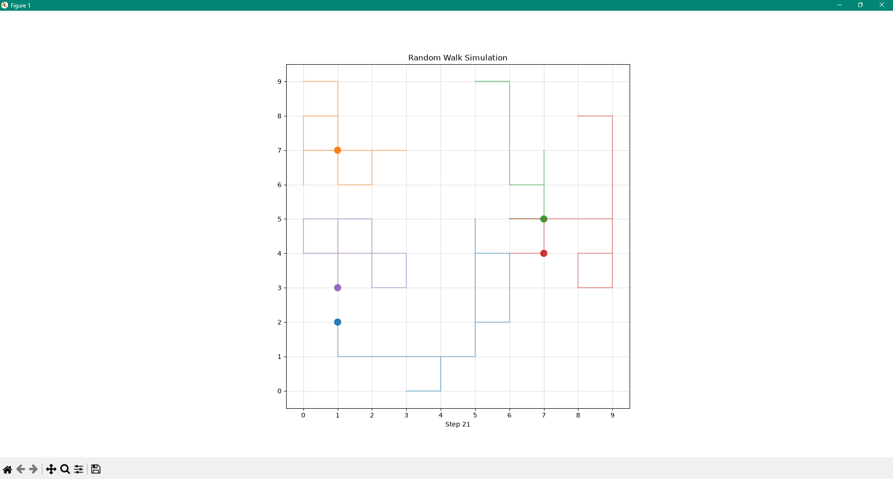

# Random Walk Simulation Using AgentPy

A grid-based multi-agent random walk simulation written in Python with [AgentPy](https://agentpy.readthedocs.io/) and Matplotlib. Each agent moves one square at a time in a random cardinal direction while staying inside the grid. The animation displays the agents and the paths they have traveled.



## Features

- Accepts the number of agents, grid size, and number of steps from the command line.
- Animates the agents on a bounded square grid.
- Records and prints every agent's path, including its starting and final positions.
- Reports final positions and the number of distinct squares occupied.
- Includes an optional collision-avoidance rule used in the scenario comparison.
- Compares a lightly populated grid with a more crowded grid.

## Requirements

- Python 3.9 or newer
- `agentpy`
- `matplotlib`

## Run the simulation

Open Command Prompt or PowerShell in this project folder, then install the dependencies:

```powershell
py -m pip install -r requirements.txt
```

Start the program:

```powershell
py TA1_Random_Walk.py
```

When prompted, enter whole numbers. For example:

```text
Enter number of agents: 5
Enter grid size (e.g., 10 for 10x10): 10
Enter number of steps: 20
```

The animation window opens. Close it when you are done watching; the program then prints each agent's final position and recorded path, followed by the scenario comparison.

If `py` is not recognized, try `python` instead. You can also run the script by giving Python its full path, for example:

```powershell
& "C:\Path\To\Python\python.exe" .\TA1_Random_Walk.py
```

Run the command from this project folder so Python can find `TA1_Random_Walk.py`.

## Movement rules

Each step, an agent chooses randomly from the valid neighboring squares: up, down, left, or right. Moves that would cross the grid boundary are excluded. In the main interactive run, agents may share a square. The comparison runs enable collision avoidance, so an agent cannot move onto a square occupied by another agent; if no valid move is available, it stays where it is.

## Laboratory tasks covered

1. **Track agent paths:** each agent stores its initial location and every position after each step.
2. **Change movement rules:** the model can run with collision avoidance enabled or disabled.
3. **Analyze final positions:** the output lists final coordinates and counts distinct occupied squares.
4. **Compare scenarios:** the program compares 5 agents on a 10×10 grid for 20 steps with 12 agents on a 5×5 grid for 50 steps.

## Project files

- `TA1_Random_Walk.py` — simulation source code.
- `TA1_RANDOMWALK.png` — example animation screenshot.
- `TA1_DELACRUZ.pdf` — Pdf file of TA1.

## Notes

Random movement can revisit earlier locations, so longer paths do not necessarily mean agents spread farther apart. The model is a simplified demonstration and does not represent every factor in real crowd movement or diffusion.
