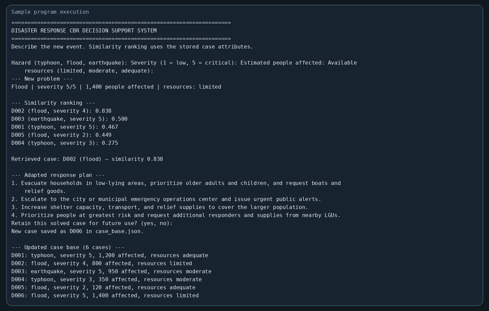

# Disaster Response Case Based Reasoning System

A small Python project for the TA3 Technical Assessment. It demonstrates how a Case Based Reasoning (CBR) system can use earlier disaster response cases to build a recommendation for a new event.

## What the program does

The program asks for a hazard type, severity, estimated number of people affected, and available resources. It compares the new event with five stored cases, ranks the cases by similarity, retrieves the closest match, adapts its response plan, and offers to retain the new case for future runs.

This is an educational demonstration. Its sample recommendations are not operational emergency guidance.

## Project structure

```text
cbr-disaster-response-github/
├── README.md
├── .gitignore
├── TA3 Technical Assesment.pdf
├── docs/
│   └── sample_execution.png
└── src/
    └── TA3_CBR_Disaster_Response.py
```

When a case is retained, the program creates `src/case_base.json`. That local data file is ignored by Git so each person can keep their own saved cases.

## Requirements

- Python 3.8 or later
- No third party packages

## Run on Windows

Open Command Prompt in the project folder and run:

```cmd
py src/TA3_CBR_Disaster_Response.py
```

If the `py` command is unavailable, try:

```cmd
python src/TA3_CBR_Disaster_Response.py
```

Follow the prompts. The hazard must be `typhoon`, `flood`, or `earthquake`; severity is from 1 to 5; resource availability must be `limited`, `moderate`, or `adequate`. Answer `yes` at the retention prompt to save the solved event.

## CBR cycle

1. **Case representation** — Each case stores an ID, hazard, severity, affected population, resource level, and response solution. The program starts with five sample cases.
2. **Similarity assessment and retrieval** — Each old case receives a score from 0.00 to 1.00. The program prints the ranking and retrieves the highest scoring case.
3. **Adaptation** — It reuses the retrieved plan, then adds or scales response actions based on the new event's severity, population, and resources.
4. **Learning and retention** — If the user chooses to retain the solved event, the program appends it to `src/case_base.json` and displays the updated case list.

## Similarity method

The score is the weighted sum of four attribute similarities:

| Attribute | Weight | Comparison |
|---|---:|---|
| Hazard type | 0.35 | 1 for an exact match; otherwise 0 |
| Severity | 0.25 | `1 - abs(new - old) / 4` |
| People affected | 0.25 | `max(0, 1 - abs(new - old) / 1500)` |
| Resources | 0.15 | Resource levels are ordered limited = 1, moderate = 2, adequate = 3; score is `1 - abs(new - old) / 2` |

The weights total 1.00. The case with the largest total is selected.

## Example run

The sample below enters a flood with severity 5, 1,400 people affected, and limited resources. The program retrieves D002 with a similarity score of 0.838, adapts the plan, saves the new case as D006, and reports six cases in the updated case base.



## Pair reflection

Our pair divided the work by having one member organize the disaster cases and similarity scoring while the other developed the adaptation rules and console output. We reviewed the program together to check whether the retrieved case fit the new event and whether the recommended changes followed the input conditions. One challenge was deciding how to compare categories such as hazard type with numerical values such as severity and affected population. We addressed this by assigning weights to each attribute and normalizing the numerical comparisons. We also had to make sure the response changed when the event was more severe, affected more people, or had limited resources. This activity helped us understand how a CBR program reuses prior experience and retains new cases for later decisions.

## Submission notes

Upload the files in this project folder to a GitHub repository. The Python program and README are the main project files; the screenshot documents one sample execution. The generated `case_base.json` is local runtime data and is not included in the repository by default.
